<div align="center">

# 🛒 B-Shop R1 — نظام إدارة المحلات المتكامل (ERP / POS)

**الإصدار:** 2.0.0 · **اللغات:** English (LTR) + العربية (RTL) · **العملة:** الجنيه المصري (EGP)

</div>

**B-Shop R1** هو الجيل الثاني من نظام **B-Shop** — إعادة بناء كاملة للمشروع الأصلي (B-Shop-V1) باستخدام بيئة حديثة: **Vite + React + TypeScript**، مع الحفاظ على تطابق الواجهات مع المشروع الأصلي.

النظام يحل مشكلة واحدة بسيطة: المحل الصغير يحتاج **فواتير + نقاط بيع + مخازن + حسابات + تقارير** في مكان واحد، بدون أنظمة معقدة أو باك إند مكلف — يبدأ بمحل واحد ويعمل مباشرة من المتصفح، ويمتد لاحقًا لعدة شركات وفروع من غير إعادة كتابة، بفضل طبقة API معزولة قابلة للتحويل إلى أي باك إند حقيقي بتغيير متغير بيئة واحد.

---

## 📸 لقطات من الاختبار البصري للمشروع

جميع اللقطات التالية مُلتقطة من النسخة المُعاد بناؤها أثناء الاختبار البصري الفعلي — نفس تدفق المستخدم الحقيقي: الإقلاع ← تسجيل الدخول ← الشروط ← الإعداد الأولي ← مساحة العمل.

<div align="center">

### شاشة الإقلاع (Splash) وتسجيل الدخول

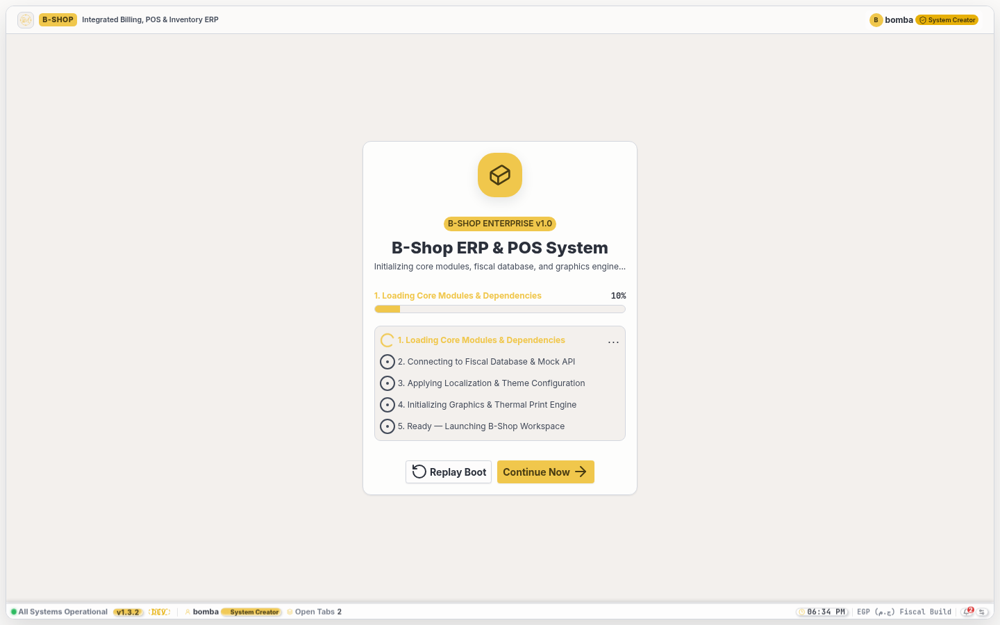
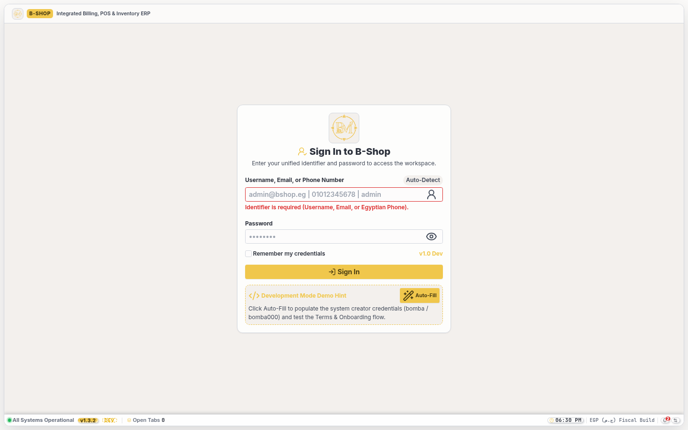

### الشروط والأحكام (5 بنود إلزامية) — بوابة لا يمكن تخطيها

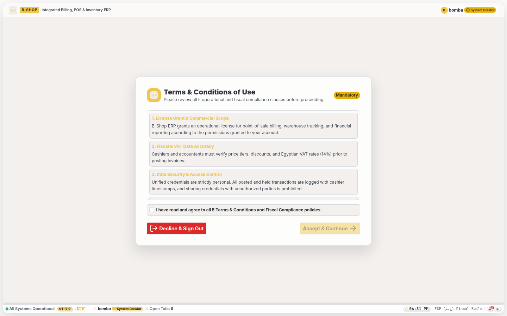

### الإعداد الأولي (معالج من 4 خطوات)

| الخطوة 1: الترحيب | الخطوة 2: ملف المشغّل |
|:---:|:---:|
| 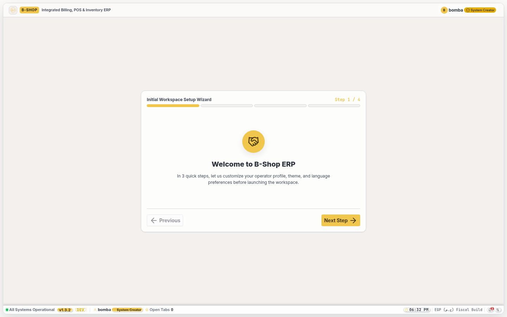 | 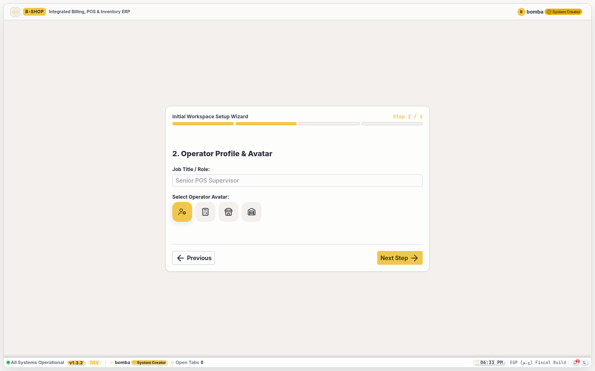 |
| **الخطوة 3: المظهر واللغة** | **الخطوة 4: جاهز!** |
| 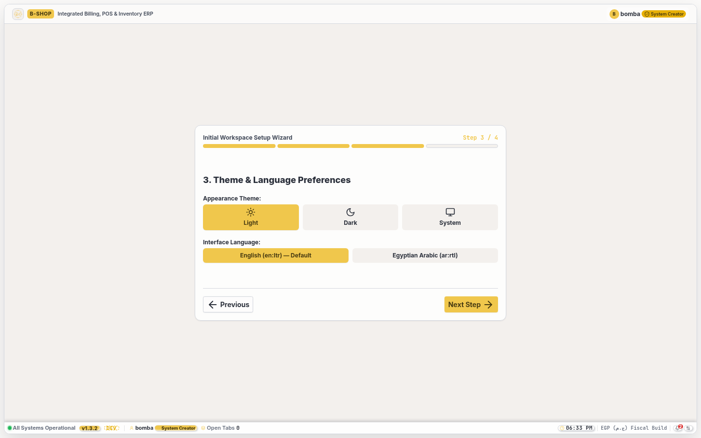 | 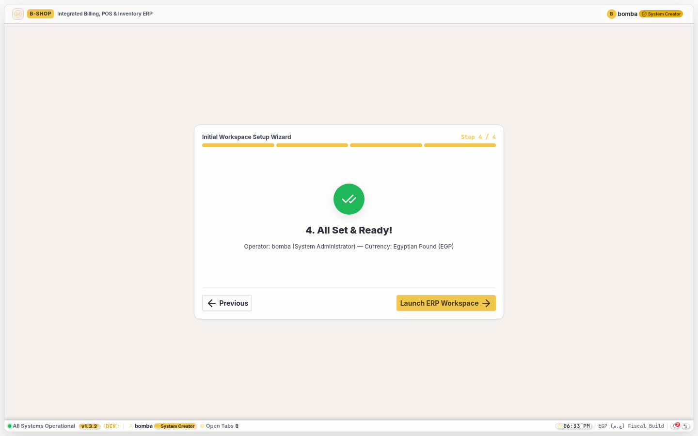 |

### مساحة العمل

| 📊 لوحة التحكم التنفيذية | 🧾 الفواتير ونقاط البيع |
|:---:|:---:|
| 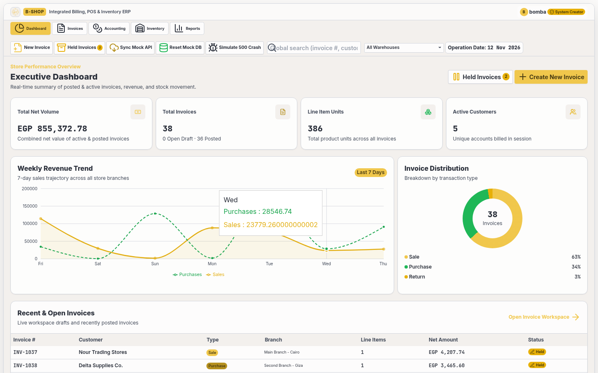 | 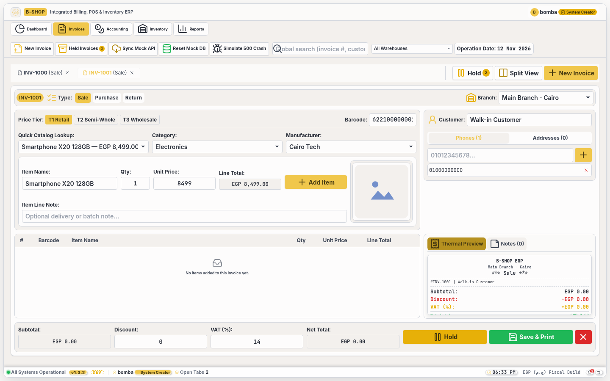 |
| **💼 الحسابات** | **📦 المخازن** |
| 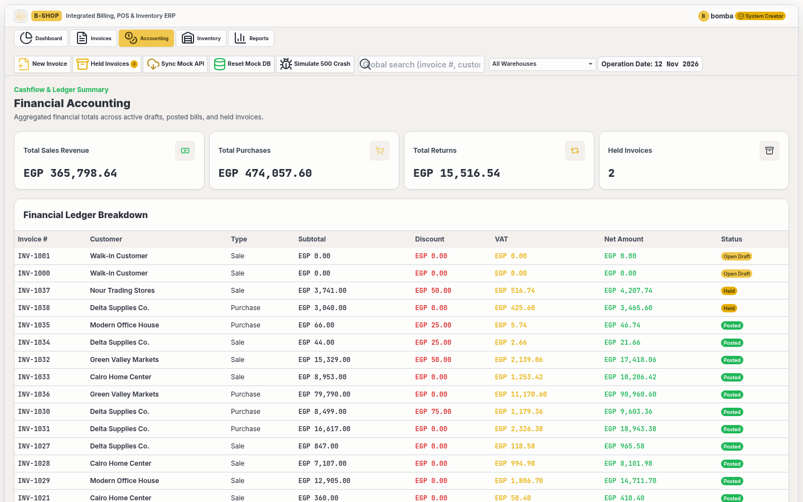 | 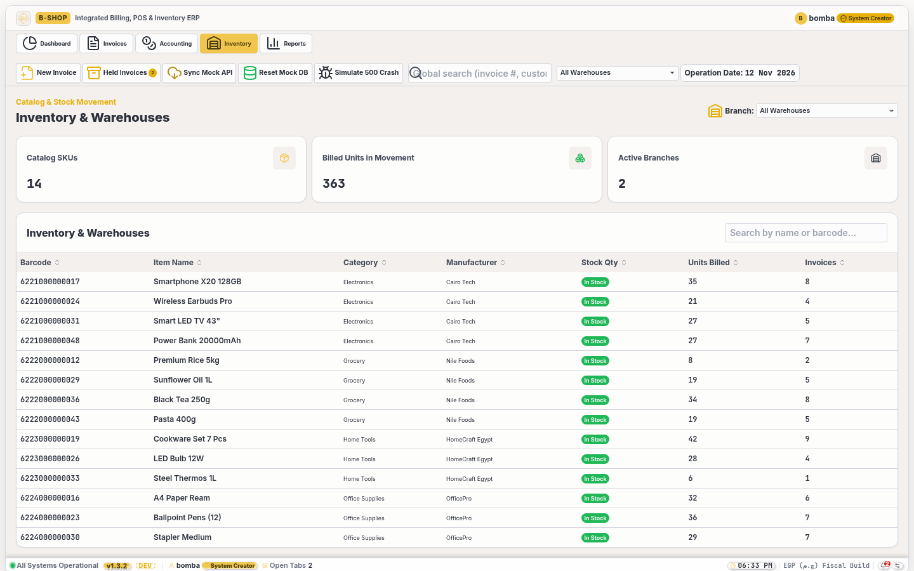 |
| **📈 التقارير التحليلية** | **🔍 صفحة 404** |
| 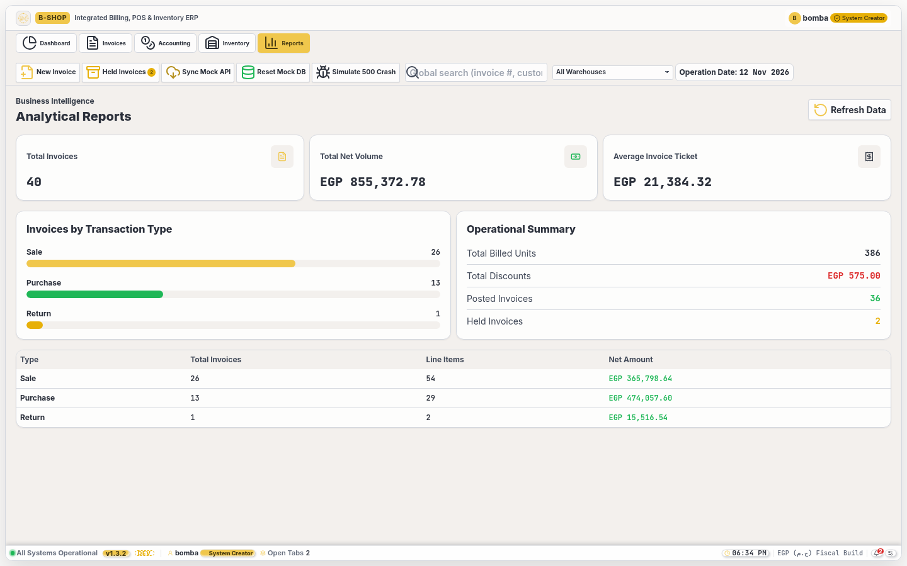 | 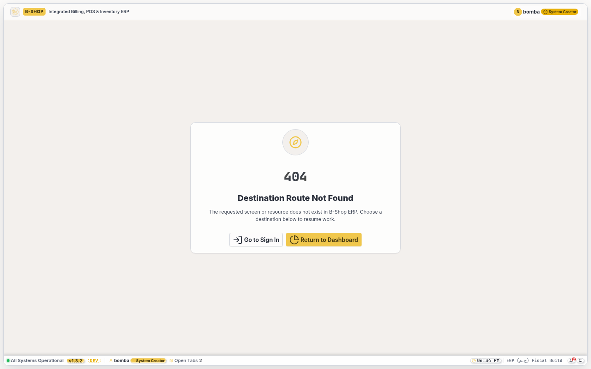 |

</div>

---

## 🔑 بيانات الدخول التجريبية (صانع النظام — المستوى 900)

| المعرّف الموحد — أي واحد منهم | كلمة المرور |
|---|---|
| `bomba` · `bomba000@bomba.com` · `bomba001@bomba.com` · `01281130712` · `01281130713` | `bomba000` |

> كلمة المرور نص تجريبي داخل طبقة الـ Mock المحلية فقط — عند التحويل لباك إند حقيقي يستخدم التشفير bcrypt من جهة الخادم.
>
> 💡 على شاشة الدخول يوجد زر **Auto-Fill** يملأ بيانات تجريبية تلقائيًا.

---

## 🚀 التثبيت والتشغيل

1. استنسخ المستودع:

   ```bash
   git clone https://github.com/ana-0001/B-Shop-R1.git
   cd B-Shop-R1
   ```

2. ثبّت الحزم:

   ```bash
   npm install
   ```

3. شغّل بيئة التطوير:

   ```bash
   npm run dev
   # يفتح على: http://localhost:3000
   ```

4. بناء الإنتاج والتشغيل المحلي للنسخة النهائية:

   ```bash
   npm run build     # فحص الأنواع + بناء الإنتاج في مجلد dist/
   npm run preview   # معاينة نسخة الإنتاج على http://localhost:3000
   ```

5. أوامر التحقق من الجودة:

   ```bash
   npm run typecheck # فحص TypeScript كامل (بدون إصدار ملفات)
   ```

---

## ✨ المزايا

- **واجهات متطابقة مع الأصل:** نفس الشاشات والتصميم وتدفق الاستخدام بالظبط — لكن بمحرك أحدث وأسرع.
- **تسجيل دخول بمعرّف موحد** مع كشف تلقائي للنوع (اسم مستخدم / بريد / موبايل مصري) وشارة حية لكل نوع.
- **قمع إلزامي بدون تخطي:** الشروط والأحكام (5 بنود) ← الإعداد الأولي (4 خطوات) ← لوحة التحكم — محفوظ في حالة المستخدم.
- **لوحة تحكم تنفيذية:** مؤشرات KPI، شارت الإيرادات الأسبوعي، دائرة توزيع أنواع الفواتير، وجدول أحدث الفواتير — كلها Recharts.
- **فواتير ونقاط بيع احترافية:** تبويبات متعددة، Split View للسلة، شرائح تسعير T1/T2/T3، تعليق واسترجاع سلة، ضريبة 14% محسوبة من دالة موحدة في كل الشاشات.
- **حسابات ومخازن وتقارير متسقة:** كل الأرقام بين الوحدات مصدرها نفس طبقة الـ Mock — بدون تعارض أبدًا.
- **ثنائي اللغة بالكامل:** English (LTR) + العربية (RTL حقيقي) — تبديل فوري من الإعداد الأولي أو شريط النظام.
- **ثيم Light / Dark / System** محفوظ ويُطبَّق لحظيًا.
- **شريط حالة النظام (System Status Bar):** ساعة حية، تاريخ العملية، إشعارات، وإعدادات — موجود في كل الشاشات.
- **طبقة Mock كاملة ومعزولة:** نموذج بيانات غني (مستخدمون، فروع، أصناف، فواتير) — التحويل لباك إند حقيقي بتغيير `VITE_API_MOCK=false` وتوفير `VITE_API_BASE_URL`.
- **جاهز لسطح المكتب:** تكامل Tauri 2 لتغليف التطبيق كبرنامج مكتبي (اختياري).

---

## 🛠️ التقنيات المستخدمة

| البند | التقنية |
|---|---|
| **اللغة أو إطار العمل:** | TypeScript 5 + React 19 + Vite 6 (SPA مع React Router 7) |
| **قاعدة البيانات:** | طبقة Mock محلية (localStorage) بنموذج بيانات كامل — قابلة للاستبدال بأي باك إند REST |
| **الأدوات أو الخدمات:** | TailwindCSS 3 · مكونات بنمط shadcn/ui (Radix Primitives) · Zustand 5 لإدارة الحالة · lucide-react للأيقونات · Recharts للرسوم البيانية · Sonner للإشعارات · Zod للتحقق · Tauri 2 (سطح مكتب — اختياري) |

---

## 📋 المتطلبات

- **Node.js** إصدار **18 أو أحدث** (يُفضَّل 20+ — بيئة التطوير المستخدمة: v24).
- **npm** إصدار 9+ (أو Bun 1.1+ كبديل).
- متصفح حديث (Chrome / Edge / Firefox / Safari بأحدث إصدارين).
- **اختياري — لنسخة سطح المكتب (Tauri):** Rust + Cargo + متطلبات النظام الخاصة بـ Tauri 2.

> لا يحتاج أي خدمات خارجية أو قواعد بيانات مثبتة مسبقًا — كل شيء يعمل محليًا من أول `npm run dev`.

---

## 🗂️ بنية المشروع

```text
b-shop-v2/
├── docs/
│   └── screenshots/        # لقطات الاختبار البصري (المستخدمة في هذا الملف)
├── src/
│   ├── components/
│   │   ├── auth/           # بطاقة الدخول ومكوناتها
│   │   ├── dashboard/      # KPI + الشارتات + جداول لوحة التحكم
│   │   ├── invoices/       # مكونات نقاط البيع والفواتير
│   │   ├── onboarding/     # معالج الإعداد الأولي (4 خطوات)
│   │   ├── shared/         # الشعار والمكونات المشتركة
│   │   ├── splash/         # شاشة الإقلاع وتسلسل الإقلاع
│   │   ├── system-status-bar/ # شريط حالة النظام (ساعة/إشعارات/إعدادات)
│   │   └── ui/             # مكتبة مكونات UI بنمط shadcn/ui
│   ├── hooks/              # useI18n، useSonner، useDocumentTitle ...
│   ├── i18n/               # إعداد الترجمة والاتجاه (LTR/RTL)
│   ├── layouts/            # AuthLayout، DefaultLayout، RouteGuard
│   ├── locales/            # en.json + ar.json
│   ├── pages/              # الصفحات العشر (Splash → 404)
│   ├── routes.tsx          # جدول المسارات الكامل
│   ├── schemas/            # مخططات Zod للتحقق
│   ├── services/           # طبقة API المعزولة (api/ + mock/)
│   ├── stores/             # متاجر Zustand (auth، invoices، ui ...)
│   ├── types/              # أنواع TypeScript المشتركة
│   └── utils/              # دوال مساعدة (ضريبة، تنسيق عملة، auth-flow)
├── index.html
├── vite.config.ts
├── tailwind.config.ts
└── package.json
```

---

## 🧭 خريطة المسارات

| المسار | الشاشة |
|---|---|
| `/` | شاشة الإقلاع (Splash) مع تسلسل الإقلاع |
| `/auth/sign-in` | تسجيل الدخول بمعرّف موحد |
| `/terms` | الشروط والأحكام (5 بنود إلزامية) |
| `/onboarding` | الإعداد الأولي (معالج 4 خطوات) |
| `/dashboard` | لوحة التحكم التنفيذية |
| `/invoices` | الفواتير ونقاط البيع |
| `/accounts` | الحسابات |
| `/inventory` | المخازن والأصناف |
| `/reports` | التقارير التحليلية |
| `*` | صفحة 404 |

---

## 🔀 ملاحظة التحويل إلى باك إند حقيقي

النظام مبني بمعمارية **Contract-First**: كل نداءات البيانات تمر عبر `src/services/api/client.ts`، وطبقة الـ Mock في `src/services/mock/` تنفّذ نفس عقد الـ API. لتحويل النظام إلى باك إند حقيقي:

```bash
# في ملف .env
VITE_API_MOCK=false
VITE_API_BASE_URL=https://your-backend.example.com/api
```

---

<div align="center">

**B-Shop R1** — مبني بعناية: نفس الواجهات، جيل أحدث من التقنيات.

</div>
